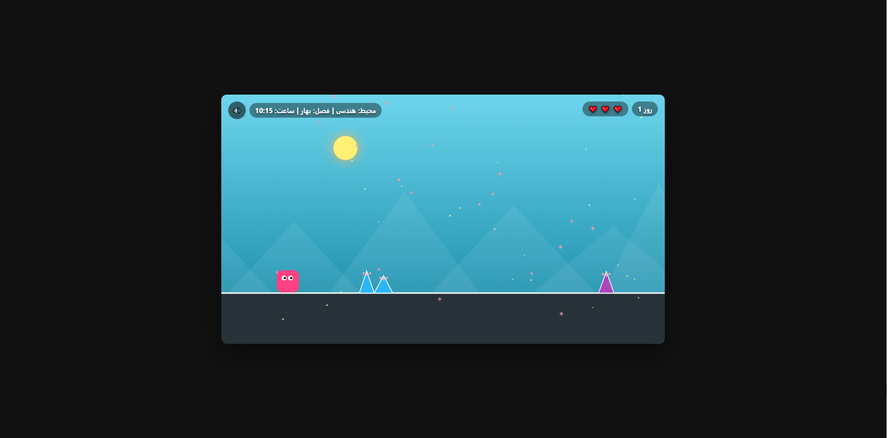

# ⚡ Gozar (گذر)


یک بازی رانر بی‌پایان (Endless Runner) مینیمال با دنیاهای متنوع، تغییر فصل‌ها و چرخه پویای شبانه‌روز که به‌صورت تک‌فایلی (`Single-File`) و بدون فریم‌ورک یا کتابخانه جانبی پیاده‌سازی شده است.

🎮 **[اجرای آنلاین و تجربه بازی](https://IamMFK.github.io/gozar/)**

> ✅ **کراس‌پلتفرم و ریسپانسیو:** بازی روی دسکتاپ، موبایل و تبلت اجرا می‌شود. برای پرش، روی دسکتاپ از کلید `Space` یا `ArrowUp` و روی دستگاه لمسی از لمس صفحه استفاده کنید.

### 🖼️ پیش‌نمایش بازی

<p align="center">
  
</p>

## 🕹️ گیم‌پلی و مکانیک‌ها

* **۱۴ محیط متنوع:** از محیط هندسی و طرح برداری تا جنگل، کویر، اقیانوس، آتشفشان، فضا و محیط‌های دیگر؛ هرکدام با ظاهر مخصوص خود.
* **چهار فصل متغیر:** بهار، تابستان، پاییز و زمستان؛ فصل بازی هر ۳ روز تغییر می‌کند.
* **چرخه شبانه‌روز:** ساعت بازی از ۰۸:۰۰ آغاز می‌شود و با حرکت پیوسته خورشید و ماه، چرخه ۲۴ ساعته را نمایش می‌دهد.
* **رانر بی‌پایان:** از موانع بپرید و تا جایی که می‌توانید به پیشروی ادامه دهید.
* **سیستم جان:** بازی با ۳ جان آغاز می‌شود. پس از برخورد، بازیکن برای مدت کوتاهی آسیب‌ناپذیر است؛ با از دست رفتن هر جان، زمان بازی به ۰۸:۰۰ برمی‌گردد و پس از تمام شدن جان‌ها، بازی از نو آغاز می‌شود.
* **جلوه‌های محیطی:** ذرات گردوغبار هنگام فرود و جزئیات گرافیکی متناسب با محیط و فصل، به فضای بازی جان می‌دهند.

## 🎮 کنترل‌ها

### 💻 دسکتاپ (Desktop)

| عمل | کنترل |
| :--- | :--- |
| **پرش / شروع بازی** | کلید `Space` یا `ArrowUp` |

### 📱 موبایل و لمسی (Mobile / Touch)

| عمل | کنترل |
| :--- | :--- |
| **پرش / شروع بازی** | لمس صفحه (`Tap`) |

## 🛠️ تکنولوژی‌ها

* **HTML5 Canvas API:** رسم محیط بازی، بازیکن، موانع و جلوه‌های بصری.
* **Vanilla JavaScript (ES6+):** منطق بازی، فیزیک، تشخیص برخورد و حلقه اجرا با `requestAnimationFrame`.
* **CSS3:** چیدمان و نمایش بازی در صفحه.

## 🚀 اجرای لوکال

برای اجرای بازی به ابزار ساخت، پکیج منیجر یا کتابخانه جانبی نیاز نیست.

فایل `index.html` را در مرورگر باز کنید یا ریپازیتوری را کلون نمایید:
```bash
git clone https://github.com/IamMFK/gozar.git
# سپس فایل index.html را در مرورگر باز کنید
